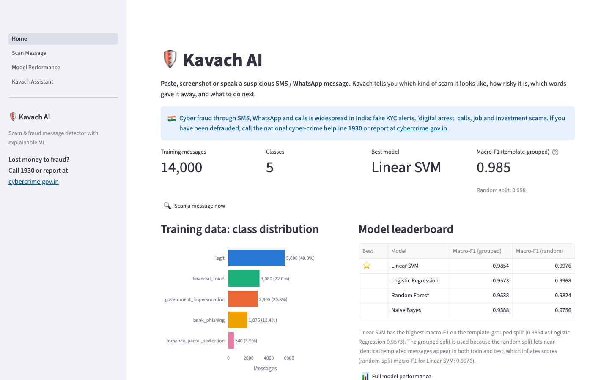
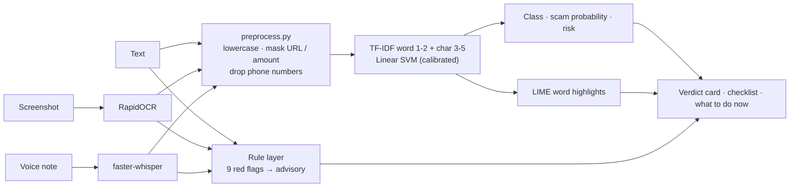
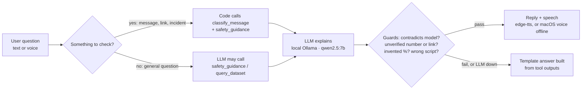
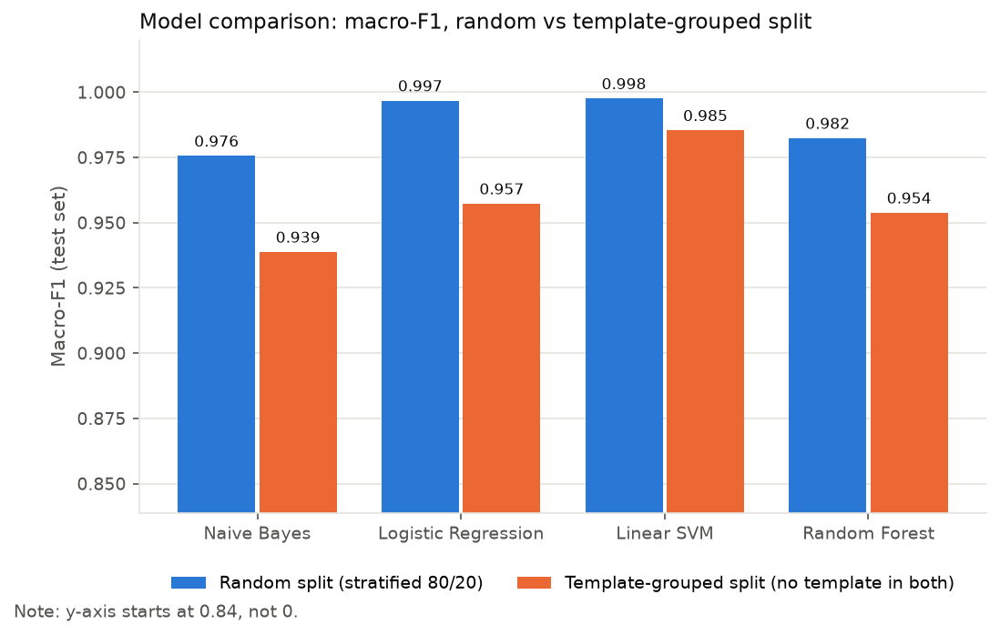
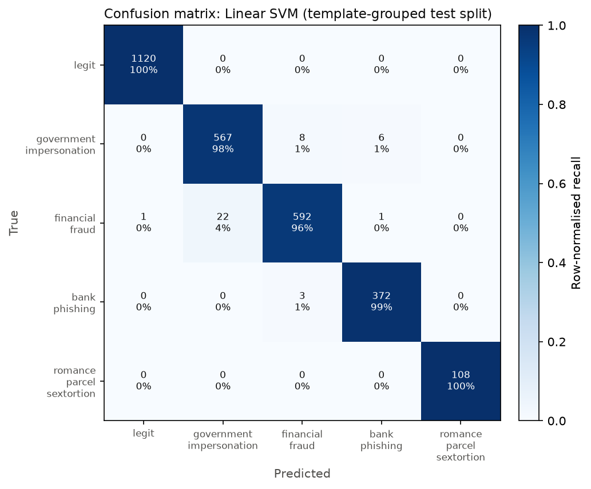
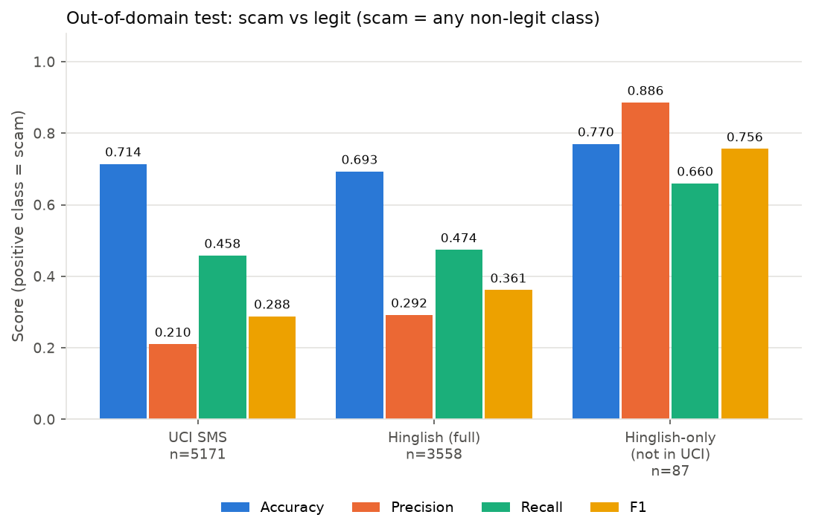
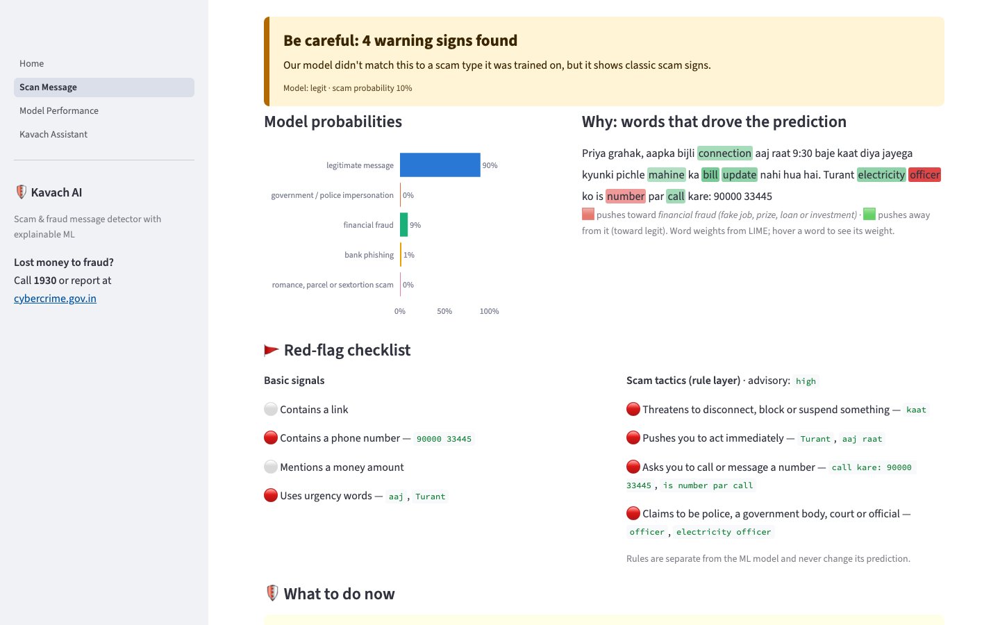
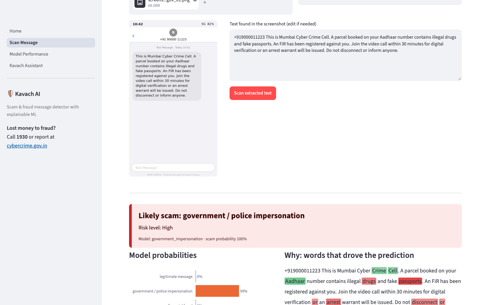
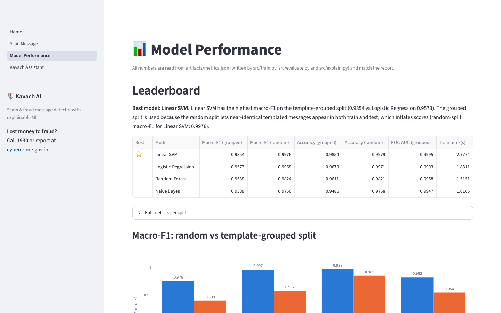
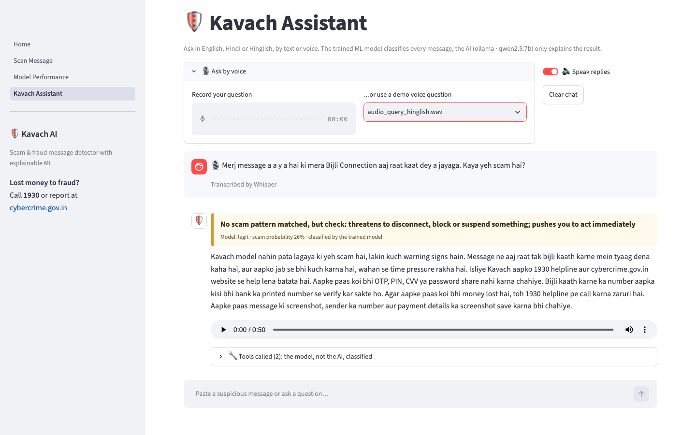

# 🛡️ Kavach AI

**Paste, screenshot or speak a suspicious SMS / WhatsApp message. Kavach tells you which kind of scam it looks like, how risky it is, which words gave it away, and what to do next.**


[](LICENSE)



> Data Science Lab mini project · Sem VII 2026-27 · Dept. of IT, SIES Graduate School of Technology, Nerul

**Runs fully on your laptop.** The classifier, OCR, speech-to-text and the assistant's language model
(Ollama `qwen2.5:7b`) all run locally; no API keys and no cloud services. Only the natural-sounding voice
(edge-tts) uses the internet, and without it replies are spoken by the built-in macOS voices.

## Project report & slides

- 📄 [Project report (PDF)](docs/Kavach_AI_Report.pdf)
- 📊 [Presentation slides (PDF)](docs/Kavach_AI_Presentation.pdf)

## The problem

People in India receive a steady stream of fraudulent SMS and WhatsApp messages: fake bank KYC alerts,
"digital arrest" calls from people posing as police or the CBI, part-time job and investment offers that
ask for a fee, and parcel or customs scams. They are written to create panic and urgency, and many people
cannot easily tell them apart from genuine bank or delivery notifications.

Kavach gives a second opinion in seconds, explains *why*, and points to the official channels:
**call the national cyber-crime helpline 1930** or report at **[cybercrime.gov.in](https://cybercrime.gov.in)**.

## Features

- **Three ways to scan**: paste text, upload a screenshot (RapidOCR), or record / upload a voice note (faster-whisper).
- **Explainable verdict**: one of 5 classes, a scam probability (`1 − P(legit)`), a risk tier
  (High ≥ 0.80, Medium 0.50–0.80, Low < 0.50) and the words that drove the prediction, highlighted with LIME.
- **Red-flag rule layer**: 9 hand-written scam tactics in English and Hindi/Hinglish (threats, urgency,
  payment or OTP requests, "new number" impersonation, authority impersonation…). It runs in parallel to the
  model, gives its own advisory, and never changes the model's prediction.
- **"What to do now"**: vetted, per-class advice. The only contacts ever shown are 1930, cybercrime.gov.in and
  "your bank on the number printed on your card".
- **Kavach Assistant**: chat by text or voice in English, Hindi or Hinglish, with spoken replies (edge-tts) and an
  expander that shows every tool call and its raw output.
- **Model Performance page**: leaderboard, confusion matrix, out-of-domain results, top words, rule-layer and
  ablation tables, all read from `artifacts/metrics.json`.

## How it works

> **The trained model classifies; the LLM only explains.**





For anything that looks like a message to check, **the code itself** runs the trained classifier before the
LLM is called, so the verdict never depends on the LLM choosing a tool. General questions ("What is a
digital arrest scam?") are never classified and get no probability. If Ollama is not running, times out
or the reply fails a guard, the user gets a template answer built from the model output and vetted guidance.

## Results

Primary data: Sentinel multiclass, 14,000 messages (0 exact duplicates),
5 classes. Two test splits:

- **Random**: stratified 80/20, `random_state=42` (11,200 train / 2,800 test).
- **Template-grouped**: `StratifiedGroupKFold` on a normalised template key (digits, URLs, phones and amounts
  masked), so no template appears in both train and test (11,200 / 2,800;
  6,693 templates). **The best model is chosen on this split.**

All models use TF-IDF (word 1-2 grams + char 3-5 grams) and balanced class weights where supported.

| Model | Macro-F1 (grouped) | Macro-F1 (random) | Accuracy (grouped) | ROC-AUC OvR (grouped) | Train time (s) |
|---|---:|---:|---:|---:|---:|
| **Linear SVM** ⭐ | 0.9854 | 0.9976 | 0.9854 | 0.9995 | 2.8 |
| **Logistic Regression** | 0.9573 | 0.9968 | 0.9679 | 0.9993 | 1.8 |
| **Random Forest** | 0.9538 | 0.9824 | 0.9611 | 0.9958 | 1.5 |
| **Naive Bayes** | 0.9388 | 0.9756 | 0.9486 | 0.9947 | 1.0 |

**Best model: Linear SVM.** Linear SVM has the highest macro-F1 on the template-grouped split (0.9854 vs Logistic Regression 0.9573). The grouped split is used because the random split lets near-identical templated messages appear in both train and test, which inflates scores (random-split macro-F1 for Linear SVM: 0.9976).

<details><summary>Per-class F1 (Linear SVM)</summary>

| Class | F1 (grouped) | F1 (random) | Test support (random) |
|---|---:|---:|---:|
| `legit` | 0.9996 | 0.9996 | 1120 |
| `government_impersonation` | 0.9692 | 0.9983 | 581 |
| `financial_fraud` | 0.9713 | 0.9968 | 616 |
| `bank_phishing` | 0.9867 | 0.9933 | 375 |
| `romance_parcel_sextortion` | 1.0000 | 1.0000 | 108 |

</details>

**Out-of-domain test (the real-world check).** Binary scam vs legit on data the model never saw
(scam = any non-legit predicted class; positive class = scam). Exact duplicates were dropped first
(UCI 403, Hinglish 229).

| Test set | n | Accuracy | Precision | Recall | F1 |
|---|---:|---:|---:|---:|---:|
| UCI SMS Spam | 5171 | 0.7142 | 0.2101 | 0.4579 | 0.2881 |
| Hinglish & English (full) | 3558 | 0.6928 | 0.2918 | 0.4739 | 0.3612 |
| Hinglish-only (rows not in UCI) | 87 | 0.7701 | 0.8857 | 0.6596 | 0.7561 |

> ⚠️ **Hinglish-only has only n = 87 messages (47 scams)**, so its scores have a
> wide margin of error. 97.6% of the full "Hinglish & English" set is the UCI SMS collection, so
> those two rows largely measure the same data.

| Model comparison | Confusion matrix (Linear SVM, grouped) | Out-of-domain |
|---|---|---|
|  |  |  |

## Honest evaluation

- **Templated training data.** Sentinel has no exact duplicates, but only 6,693 distinct templates
  across 14,000 rows (52.2% of rows repeat a template once digits, links, phones and
  amounts are masked). A random split puts near-identical messages in both train and test, which is why every
  model scores higher on it: Naive Bayes 0.9756 → 0.9388, Logistic Regression 0.9968 → 0.9573, Linear SVM 0.9976 → 0.9854, Random Forest 0.9824 → 0.9538 (macro-F1, random → grouped).
- **Even the grouped split is optimistic.** Templates that differ only in a bank or agency name still count as
  different templates, so ~0.985 grouped macro-F1 is an upper bound,
  not a real-world estimate. The out-of-domain table is the realistic picture.
- **Bank- and agency-name shortcuts.** The most indicative words per class include specific names, so the
  model partly learns *who* a message names rather than the tactic. Top words: `legit`: app, otp, order, successfully, txn; `government_impersonation`: si, cybercrime, trai, pan card, your pan; `financial_fraud`: pnb visa, pnb fraud, ncb, your sim, sim card; `bank_phishing`: india security, bank visa, bank transaction, bank, bank fraud; `romance_parcel_sextortion`: video, adult, help me, your screen, hi.
- **No casual chat in the legit class.** Sentinel's legit messages are service notifications (banks,
  recharges, deliveries). Ordinary personal messages are often flagged as scams, hence the low out-of-domain
  precision (UCI: 0.2101).
- **Label noise.** Similar messages (e.g. "PNB Fraud Alert" templates, NCB impersonation, parcel/customs
  scams) appear under different classes, so the exact scam *type* is less reliable than scam vs legit.
- **Phone-number shortcut, removed.** Phone numbers occur in 0.0% of scam rows and
  16.2% of legit rows, so a `<PHONE>` token teaches "phone number → legit". The
  final model never sees phone numbers (they still appear in the red-flag checklist):

| | Macro-F1 grouped | UCI F1 | UCI recall | Hinglish-only F1 |
|---|---:|---:|---:|---:|
| With a `<PHONE>` token | 0.9851 | 0.2422 | 0.3783 | 0.7561 |
| Phone numbers removed (final model) | 0.9854 | 0.2881 | 0.4579 | 0.7561 |

- **Rule layer.** Written from general scam-awareness guidance without looking at the out-of-domain rows.
  It raises few false alarms but adds little recall at the "high" threshold:

| Legit messages | n | Advisory ≠ none | Advisory = high |
|---|---:|---:|---:|
| Sentinel legit (test split) | 1120 | 6.16% | 0.00% |
| UCI ham | 4518 | 0.04% | 0.00% |

| Scam recall | Scams | ML only | ML **or** advisory = high |
|---|---:|---:|---:|
| UCI SMS | 653 | 0.4579 | 0.4579 |
| Hinglish-only | 47 | 0.6596 | 0.6809 |

  The demo samples in `demo_samples/` were seen while writing the rules, so they are not an independent test of it.

Full analysis: [`notebooks/01_eda_and_modelling.ipynb`](notebooks/01_eda_and_modelling.ipynb).

## Screenshots

| Scan: text (rule layer flags a scam type the model missed) | Scan: screenshot (OCR) |
|---|---|
|  |  |
| **Model performance** | **Assistant: Hinglish voice query** |
|  |  |

## Tech stack

| Area | Tools |
|---|---|
| ML | scikit-learn (TF-IDF, Linear SVM, Logistic Regression, Naive Bayes, Random Forest), LIME |
| Data & plots | pandas, NumPy, matplotlib, seaborn, Plotly, Jupyter |
| App | Streamlit (multipage) |
| Speech & OCR | faster-whisper (`small`, CPU int8), edge-tts (`en-IN-NeerjaNeural`, `hi-IN-SwaraNeural`) with macOS `say` (Rishi, Lekha) offline, RapidOCR (ONNX Runtime) |
| LLM | Ollama `qwen2.5:7b` running locally (OpenAI-compatible API), with tool calling |
| Testing | pytest, Streamlit AppTest, Playwright (screenshots) |

## Run it

1. Install [Ollama](https://ollama.com/download) and start the Ollama app.
2. Then:

```bash
git clone https://github.com/Yuvrajvarthan/kavach-ai.git && cd kavach-ai
python3.11 -m venv .venv && source .venv/bin/activate
pip install -r requirements.txt
ollama pull qwen2.5:7b               # the Assistant's local language model (4.7 GB, one time)
streamlit run app/Home.py            # opens http://localhost:8501
```

No `.env` is needed; copy `.env.example` to `.env` only to change the model or voices. The first voice scan
downloads the Whisper `small` model once (about 460 MB).

The trained model is committed in `artifacts/`, so no training is needed. The Scan and Model Performance pages
work without any LLM; without one, the Assistant answers in offline template mode.

## Retrain from scratch

```bash
python scripts/download_data.py      # 3 datasets → data/raw/ (gitignored)
python -m src.train                  # 4 models × 2 splits, saves artifacts/model.joblib
python -m src.evaluate               # OOD, EDA, rule layer → artifacts/metrics.json + figures
python -m src.explain                # top words → metrics.json, top_words_per_class.png
jupyter nbconvert --to notebook --execute --inplace notebooks/01_eda_and_modelling.ipynb
python scripts/build_readme.py       # regenerate this README from metrics.json
```

## Tests

```bash
pip install -r requirements-dev.txt && playwright install chromium
python -m pytest tests -q            # live-LLM tests are skipped if Ollama isn't running
python scripts/check_scan_pipeline.py   # all demo texts, screenshots (OCR) and audio (Whisper)
python scripts/check_assistant.py       # assistant scenarios incl. prompt injection and offline mode
python scripts/take_screenshots.py      # regenerate docs/screenshots (app must be running)
```

## Project structure

```
app/            Streamlit app: Home.py, pages/ (Scan, Model Performance, Assistant),
                llm.py, tools.py, speech.py, ocr.py, scan_core.py
src/            preprocess, train, evaluate, explain, predict, red_flags, guidance
artifacts/      model.joblib, metrics.json, confusion matrices
notebooks/      01_eda_and_modelling.ipynb
reports/figures/  report and PPT figures
demo_samples/   fictional test messages, screenshots and voice clips
scripts/        data download, README builder, pipeline checks, screenshots
tests/          pytest + Streamlit AppTest
```

## Datasets & licenses

| Dataset | Used for | License |
|---|---|---|
| [Sentinel multiclass](https://huggingface.co/datasets/Shade63/scam-classification-multiclass) (Shade63) | Training and in-domain test | License not specified on the dataset card (it says "Same as original dataset" without naming one) |
| [Hinglish & English scam text](https://huggingface.co/bolewara/hinglish-scam-text-dataset) (Anuj Bolewar) | Out-of-domain test | CC BY 4.0 |
| [SMS Spam Collection](https://archive.ics.uci.edu/dataset/228/sms+spam+collection) (T. A. Almeida, J. M. Gómez Hidalgo; UCI, DOI [10.24432/C5CC84](https://doi.org/10.24432/C5CC84)) | Out-of-domain test | CC BY 4.0 |

The datasets are not redistributed in this repository; `scripts/download_data.py` fetches them.
All messages in `demo_samples/` are fictional.

## Limitations & future work

- **DistilBERT**: fine-tune `distilbert-base-multilingual-cased` and compare it with the Linear SVM.
- **More scam types**: utility-disconnection, "new number, send money", loan-app and sextortion scripts are thin or
  missing in the training data; today only the rule layer catches some of them.
- **Relabelling**: fix the inconsistent class boundaries (PNB fraud alerts, NCB impersonation, parcel scams).
- **A real Hinglish dataset**: the Hinglish-only test has 87 rows; real code-mixed messages
  (and casual legit chat) are needed for both training and evaluation.
- **User-feedback loop**: let users mark wrong verdicts, review them, and use them to retrain.
- A larger local LLM (when hardware allows) for more natural Hindi/Hinglish explanations; the guards stay either way.

## Team

**Group 17**: Nadar Yuvrajvarthan Murugesh · Akash Sivan Konar
Guide: **Ms. Savita Lohiya** · HOD: Prof. Leena Ladge
Data Science Lab mini project 2026-27, Department of Information Technology, SIES Graduate School of Technology, Nerul.

## Disclaimer

Kavach is an educational project. Its verdicts can be wrong; "no scam pattern detected" does not mean a message
is safe. If you think you have been defrauded, call **1930** or report at **[cybercrime.gov.in](https://cybercrime.gov.in)**.

Licensed under the [MIT License](LICENSE).
